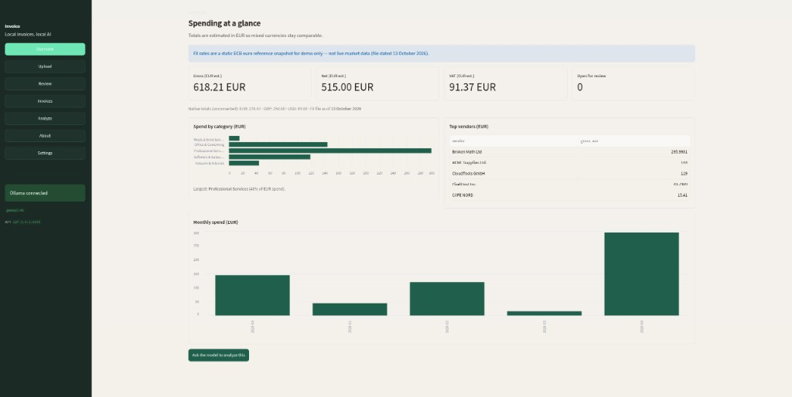
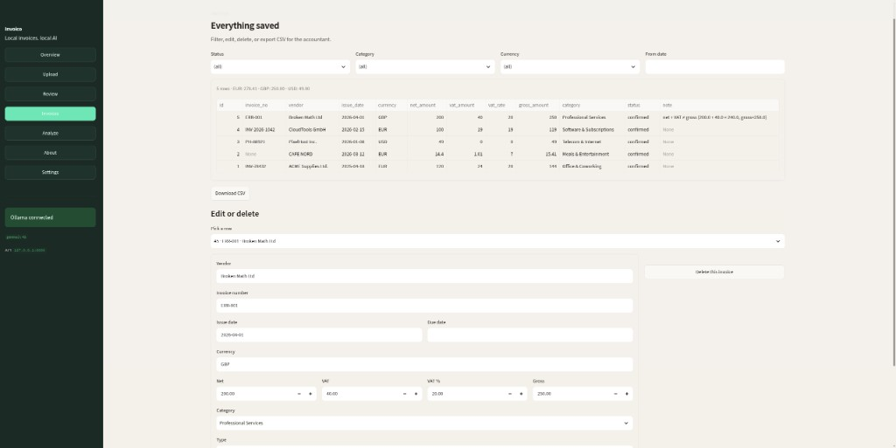
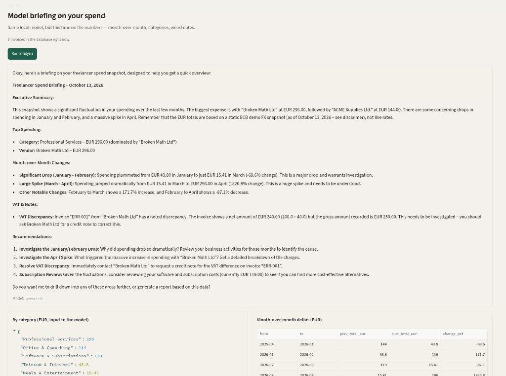

# Invoico

Local invoice & receipt assistant. Drop in a PDF or a phone photo, a vision model on your machine pulls out the fields, Python checks the math, you confirm, and you get a CSV for the accountant.

Nothing is sent to a cloud API. That is the product.

I built this for the [Hacktoberfest 2026 Open-Source AI Challenge — Week 2 (Side Hustle)](https://dev.to/challenges/hacktoberfest-week2-2026-10-12).

**Demo:** [https://youtu.be/Cl_LL_XIZYI](https://youtu.be/Cl_LL_XIZYI)







## Side hustle (where this actually goes)

This is **not** a SaaS. I am not spinning up user accounts and a shared database so your invoices sit on my servers — that would throw away the whole privacy angle.

It is also not an enterprise self-hosted platform. Freelancers do not want to babysit Postgres for a receipt folder.

**The real product shape is packaged software:** you install it (or `docker compose up`), Ollama runs on your machine, SQLite stays local. Pay once for a polished build, or yearly if you want updates as models change and the defaults stay sharp. Inference cost stays on the customer’s hardware, so there is no per-document bill for me to pass on.

This repo stays MIT so you can run it yourself, poke at it, or self-host the compose stack if that fits. The paid bit — if / when I ship it — is the install, support, and keeping the eval-backed defaults honest.

## What you get

- Upload PDF / JPG / PNG
- Local extraction via Ollama (Gemma by default)
- Validation (`net + VAT ≈ gross`, line items vs total, cash ≠ total)
- Review + confirm (notes stay if you confirm a mismatch as-is)
- Same invoice # replaces the same row
- Overview + Analyze with **EUR-estimated** totals when currencies are mixed
- Edit / delete invoices, clear the DB from Settings
- Light / dark theme from the sidebar
- CSV export
- Tiny eval harness under `eval/`

## Currency conversion (demo)

Overview and Analyze convert amounts into **EUR** using a **static** ECB euro reference file: `fx/eurofxref.csv`.

**Disclaimer:** those rates are a snapshot for demo / challenge write-up purposes only. They are **not** live market data, not updated automatically, and **not** suitable for real accounting, tax filings, or trading. Native currency totals are still shown next to the EUR estimates. Swap in a newer CSV if you want a fresher demo snapshot — see `fx/README.md`.

## Quick start (local)

```bash
# 1. Ollama + a small vision model
ollama pull gemma3:4b

# 2. Python
git clone https://github.com/mohamedation/invoico.git
cd invoico
python -m venv .venv && source .venv/bin/activate
pip install -r requirements.txt
cp .env.example .env
python scripts/make_samples.py

# 3. Two terminals
uvicorn app.api.main:app --host 127.0.0.1 --port 8000
streamlit run app/ui/streamlit_app.py
```

Open http://localhost:8501 — sidebar has Overview, Upload, Review, Invoices, Analyze, About, Settings.

## Docker Compose

Ollama still runs on the host (GPU / model cache is happier that way):

```bash
ollama pull gemma3:4b
docker compose up --build
```

- UI → http://localhost:8501  
- API → http://localhost:8000/health  

Override the model with `MODEL=gemma3:12b docker compose up --build`.

On Linux the compose file maps `host.docker.internal` to the host gateway so containers can reach Ollama on port 11434.

## Config

`.env` (or compose env):

```
MODEL=gemma3:4b
OLLAMA_HOST=http://127.0.0.1:11434
```

| Tag | Notes |
|---|---|
| `gemma3:4b` | **Default** — clearly better on real scanned receipts (cash vs total) |
| `gemma4:e2b` | Faster / smaller, but mixes up cash tendered and store IDs with the bill total |
| `gemma4:e4b` | Worth trying if you have the RAM |

Compare locally: `python eval/run_eval.py --compare gemma3:4b gemma4:e2b`

## Eval

```bash
python eval/run_eval.py
```

Prints a markdown table and writes `eval/results.json`.

## Tests

```bash
pytest -q
```

## Layout

```
app/api/       FastAPI
app/core/      extract, validate, analyze, fx, db, pipeline
app/ui/        Streamlit
docs/          screenshots for README / write-up
fx/            static ECB eurofxref.csv (demo FX)
eval/          ground truth + runner
samples/       fake invoices only
docker-compose.yml
```

## Privacy

- Binds to localhost (compose exposes ports on your machine only)
- `data/` is gitignored
- Samples in the repo are synthetic — do not commit real invoices

## License

MIT
